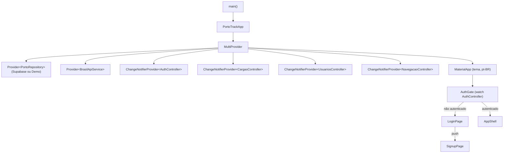
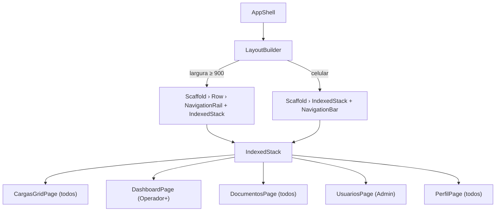
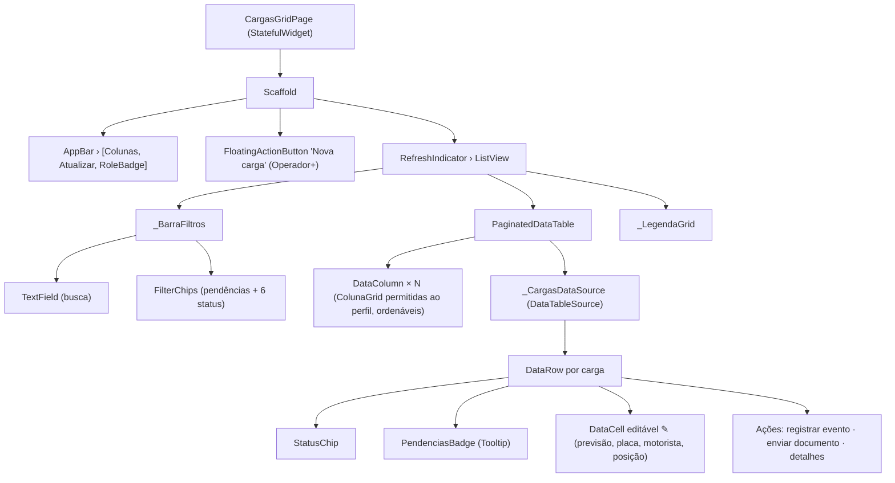
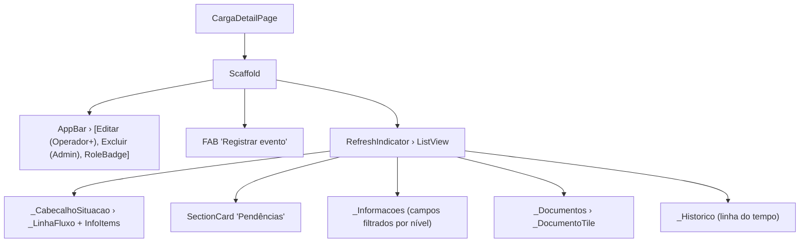
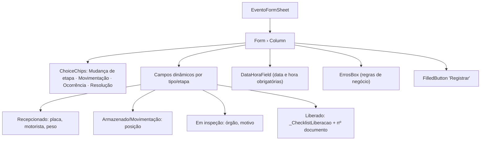
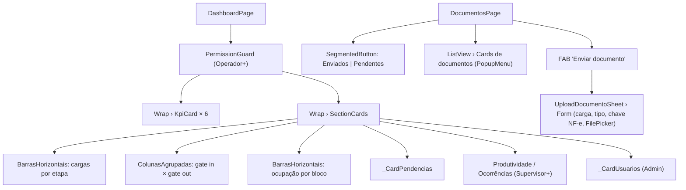

# Widget Tree — PortoTrack

Árvores simplificadas dos principais widgets (apenas os nós relevantes para
estrutura, estado e navegação). As imagens renderizadas estão em `docs/img/`.

## 1. Raiz da aplicação e gerenciamento de estado

## 2. AppShell — módulos filtrados por perfil

## 3. Módulo principal — GRID de cargas

## 4. Detalhe da carga

## 5. Registro de evento (bottom sheet)

## 6. Dashboard e Documentos

